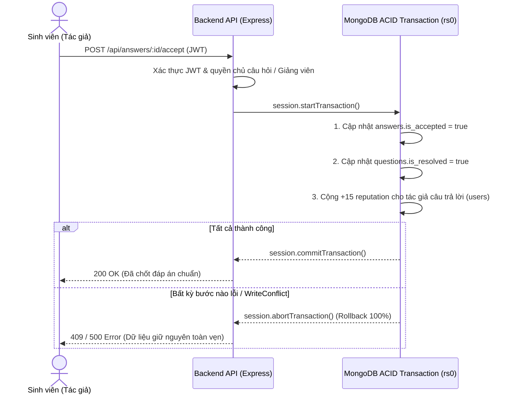
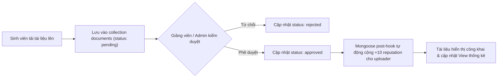
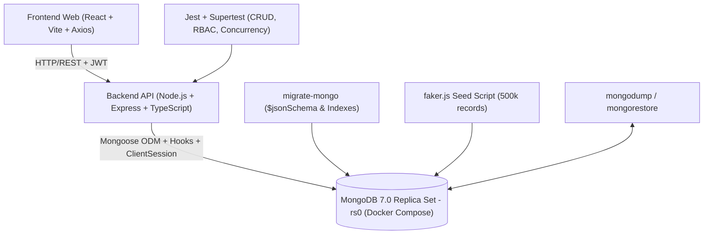

# CHƯƠNG 1: TỔNG QUAN ĐỀ TÀI VÀ ĐẶC TẢ YÊU CẦU HỆ THỐNG (SRS)

- **Đề tài:** Nền tảng hỏi đáp học thuật và lưu trữ tri thức (**edUTT**)
- **Đơn vị:** Nhóm 1 — Đồ án học phần Cơ sở dữ liệu — Trường Đại học Công nghệ Giao thông Vận tải
- **Người phụ trách chính (Tuần 1):** Phạm Văn Thanh (Nhóm trưởng) — Phối hợp: Cả nhóm
- **Chuẩn đầu ra đáp ứng:** CLO1, CLO7

---

## 1.1. Bối cảnh thực tiễn và mục tiêu bài toán

### 1.1.1. Thực trạng bài toán
Hiện nay, nhu cầu trao đổi học thuật, hỏi đáp bài tập/đồ án và chia sẻ tài liệu ôn thi theo từng học phần của sinh viên tại trường đại học vẫn diễn ra phân tán trên nhiều nhóm mạng xã hội (Facebook, Zalo, Messenger). Cách làm này bộc lộ 3 hạn chế lớn:
1. **Tri thức bị trôi và phân mảnh:** Câu hỏi cũ lặp lại qua từng kỳ học, khó tra cứu lại theo mã môn học hoặc từ khóa chuyên ngành.
2. **Thiếu cơ chế kiểm chứng chất lượng:** Không có công cụ đánh dấu đáp án chính xác nhất hay xếp hạng câu trả lời dựa trên mức độ tin cậy của cộng đồng và giảng viên.
3. **Không có kho lưu trữ tài liệu chuẩn hóa:** Đề cương, slide, tài liệu tham khảo thiếu phân loại theo học phần và chưa qua khâu kiểm duyệt.

### 1.1.2. Mục tiêu hệ thống edUTT
Xây dựng nền tảng **edUTT** giải quyết triệt để các vấn đề trên với 4 mục tiêu trọng tâm:
- Tập trung hóa hoạt động hỏi đáp học thuật theo danh mục môn học của nhà trường (`subjects`).
- Chuẩn hóa chất lượng tri thức thông qua bình chọn cộng đồng (**Upvote / Downvote**), cơ chế chốt đáp án chuẩn (**Accepted Answer**) và tích lũy điểm uy tín (**Reputation**).
- Xây dựng kho tài liệu học tập có quy trình kiểm duyệt (`pending` → `approved` / `rejected`).
- Ứng dụng triệt để các kỹ thuật chuyên sâu của **MongoDB** (Embedding vs. Referencing, `$jsonSchema`, Aggregation Pipeline, Read-only Views, Weighted Text Index, Compound Index ESR, Multi-document ACID Transaction, RBAC 2 lớp và Backup/Restore).

---

## 1.2. Phân tích tác nhân (Actors) và Ma trận phân quyền (RBAC)

Hệ thống chia người dùng thành **3 vai trò (Roles)** rõ ràng, được kiểm soát ở cả tầng API (JWT Middleware) và tầng Database (MongoDB Users/Roles):

| Chức năng / Quyền hạn | Sinh viên (`student`) | Giảng viên / Kiểm duyệt (`lecturer`) | Quản trị viên (`admin`) |
| :--- | :---: | :---: | :---: |
| Đăng ký, đăng nhập, xem & cập nhật hồ sơ cá nhân | ✅ | ✅ | ✅ |
| Tìm kiếm toàn văn, lọc câu hỏi theo môn học, xem chi tiết | ✅ | ✅ | ✅ |
| Đặt câu hỏi, gắn thẻ môn học (`subject_tags`) | ✅ | ✅ | ✅ |
| Viết bình luận ngắn (`short_comments`), gửi câu trả lời (`answers`) | ✅ | ✅ | ✅ |
| Upvote / Downvote câu hỏi & câu trả lời (1 lần/bài) | ✅ | ✅ | ✅ |
| Chấp nhận đáp án chuẩn (`is_accepted`) cho câu hỏi của chính mình | ✅ (chủ câu hỏi) | ✅ | ✅ |
| Tải lên tài liệu học tập (trạng thái mặc định `pending`) | ✅ | ✅ | ✅ |
| Duyệt / Từ chối tài liệu học tập (`approved` / `rejected`) | ❌ | ✅ | ✅ |
| Kiểm duyệt / Xóa nội dung vi phạm (câu hỏi, câu trả lời) | ❌ (chỉ bài của mình) | ✅ | ✅ |
| Xem bảng xếp hạng Top Contributors & Thống kê môn học (Views) | ✅ | ✅ | ✅ |
| Quản lý danh mục môn học (`subjects`: Thêm/Sửa/Xóa + đồng bộ tag) | ❌ | ❌ | ✅ |
| Quản lý tài khoản người dùng & gán vai trò (`role`) | ❌ | ❌ | ✅ |

### Phân quyền 2 lớp (RBAC 2-Layer)
- **Lớp 1 (Tầng API):** Xác thực JWT Token (`Authorization: Bearer <token>`) và kiểm tra `req.user.role` trước khi thực thi Controller.
- **Lớp 2 (Tầng Database MongoDB):**
  - Tài khoản ứng dụng (`edutt_app`): cấp quyền `readWrite` trên database `edutt_db`.
  - Tài khoản báo cáo/thống kê (`edutt_readonly`): chỉ cấp quyền `read` trên `edutt_db` (không dùng tài khoản `root` để vận hành ứng dụng).

---

## 1.3. Phân tích yêu cầu chức năng (Functional Requirements)

### FR1 — Phân hệ Quản lý người dùng & Xác thực (Auth & Users)
- **FR1.1:** Đăng ký tài khoản mới với mã sinh viên/giảng viên (`student_code`), họ tên (`full_name`), email duy nhất (`email`) và mật khẩu băm bằng `bcryptjs`.
- **FR1.2:** Đăng nhập và cấp phát JWT Token chứa `user_id` và `role`.
- **FR1.3:** Xem hồ sơ học thuật cá nhân gồm điểm uy tín (`reputation` ≥ 0), số câu hỏi đã đăng, số câu trả lời được chấp nhận.
- **FR1.4:** Quản trị viên quản lý danh sách người dùng và thay đổi phân quyền (`student`, `lecturer`, `admin`).

### FR2 — Phân hệ Quản lý Danh mục Môn học (Subjects)
- **FR2.1:** Quản trị viên tạo, sửa, xóa danh mục học phần (`subject_code` duy nhất, `subject_name`, `credits`, `department`).
- **FR2.2:** Khi tên hoặc mã môn học thay đổi, hệ thống tự động đồng bộ mảng nhúng `subject_tags` trong toàn bộ collection `questions` thông qua thao tác `updateMany()`.

### FR3 — Phân hệ Hỏi đáp học thuật (Q&A)
- **FR3.1:** Đăng câu hỏi kèm tiêu đề, nội dung chi tiết (hỗ trợ mã nguồn/công thức) và danh sách thẻ môn học (`subject_tags`). Tự động chuẩn hóa trường tìm kiếm tiếng Việt không dấu (`search_normalized`).
- **FR3.2:** Thêm bình luận ngắn (`short_comments`) trực tiếp dưới câu hỏi (nhúng trong document `questions`, giới hạn tối đa độ dài ký tự và số lượng phần tử để tránh phình to document).
- **FR3.3:** Đăng câu trả lời chi tiết (`answers`) tham chiếu tới `question_id` và `author_id`; hỗ trợ phân trang và sắp xếp ưu tiên đáp án chuẩn (`is_accepted: true`) rồi đến số lượt bình chọn (`vote_count` giảm dần).
- **FR3.4:** Bình chọn Upvote (`+1`) / Downvote (`-1`) cho câu hỏi hoặc câu trả lời, chặn tuyệt đối 1 người vote trùng lặp trên cùng 1 đối tượng.
- **FR3.5:** Chốt đáp án chuẩn (`Accept Answer`): đánh dấu `answers.is_accepted = true`, cập nhật `questions.is_resolved = true` và cộng `+15` điểm uy tín cho tác giả câu trả lời trong cùng một **Multi-document ACID Transaction**.

### FR4 — Phân hệ Lưu trữ Tri thức & Tìm kiếm (Documents & Search)
- **FR4.1:** Sinh viên/Giảng viên tải lên tài liệu học tập (`documents`) gắn với một môn học (`subject_id`).
- **FR4.2:** Giảng viên/Admin kiểm duyệt tài liệu (`approved` / `rejected`). Khi tài liệu chuyển sang `approved`, Mongoose Hook tự động cộng `+10` điểm uy tín cho người tải lên.
- **FR4.3:** Tìm kiếm toàn văn (Full-text Search) có trọng số ưu tiên tiêu đề > tên môn học > nội dung, hỗ trợ tiếng Việt có dấu và không dấu; kết hợp lọc theo mã môn học và trạng thái giải đáp (`is_resolved`).

### FR5 — Phân hệ Thống kê & Báo cáo học thuật (Analytics & Views)
- **FR5.1:** Bảng xếp hạng Top thành viên đóng góp nổi bật truy xuất từ MongoDB Read-only View `v_top_contributors`.
- **FR5.2:** Thống kê tri thức theo môn học (tổng câu hỏi, số câu hỏi đã giải đáp, tỷ lệ giải đáp %, tổng tài liệu đã duyệt) truy xuất từ MongoDB Read-only View `v_subject_knowledge_stats`.

---

## 1.4. Phân tích yêu cầu phi chức năng (Non-Functional Requirements)

| Nhóm yêu cầu | Chỉ tiêu kỹ thuật cần đạt | Giải pháp thực thi |
| :--- | :--- | :--- |
| **NFR1 — Hiệu năng truy vấn** | Tìm kiếm toàn văn & lọc câu hỏi trên tập **100.000 – 500.000 bản ghi** đạt phản hồi nhanh (mục tiêu < 50ms, giảm > 90% so với `COLLSCAN`). | Weighted Text Index + Compound Index theo quy tắc **ESR**, kiểm chứng qua `explain("executionStats")`. |
| **NFR2 — Tính nguyên tử & Đồng thời** | Khi 100+ người dùng cùng bấm Upvote/Chốt đáp án đồng thời, không phát sinh lỗi Race Condition, Lost Update hay sai lệch `vote_count` / `reputation`. | Compound Unique Index trên `votes` + **Multi-document ACID Transaction** (`ClientSession`) trên Replica Set + Stress Test `Promise.all()`. |
| **NFR3 — Toàn vẹn dữ liệu** | Mọi thao tác ghi sai kiểu, thiếu trường bắt buộc hoặc `reputation < 0` phải bị chặn ngay tại nhân CSDL. | `$jsonSchema` Validation (`validationLevel: "strict"`, `validationAction: "error"`) cài đặt qua `migrate-mongo`. |
| **NFR4 — Khả năng phục hồi** | Có khả năng sao lưu nóng khi hệ thống đang chạy và khôi phục toàn vẹn 100% sau sự cố xóa nhầm collection. | Script tự động `mongodump --gzip` và diễn tập `mongorestore --drop`. |
| **NFR5 — Khả năng bảo trì & Kiểm thử** | Bộ kiểm thử tự động API, `$jsonSchema`, RBAC và Concurrency đạt tỷ lệ **PASS 100%**. | Kiến trúc phân tầng TypeScript + Jest + Supertest (`--runInBand`). |

---

## 1.5. Phân tích 6 thực thể cốt lõi (Core Entities)

Dự kiến mô hình hóa thành **6 Collection chính** trong MongoDB (chi tiết sơ đồ & kiểu dữ liệu sẽ được chốt ở Tuần 2):

1. **`users`**: Thông tin tài khoản, vai trò (`student | lecturer | admin`) và điểm uy tín (`reputation >= 0`).
2. **`subjects`**: Danh mục học phần (`subject_code`, `subject_name`, `credits`, `department`).
3. **`questions`**: Câu hỏi học thuật; **nhúng (Embed)** mảng `subject_tags` (Extended Reference Pattern) và mảng `short_comments` (One-to-Few có giới hạn).
4. **`answers`**: Câu trả lời chi tiết; **tham chiếu (Reference)** tới `question_id` và `author_id`, lưu `vote_count`, `is_accepted`.
5. **`documents`**: Metadata tài liệu học tập; **tham chiếu (Reference)** tới `subject_id` và `uploader_id`, lưu trạng thái kiểm duyệt `status`.
6. **`votes`**: Lịch sử bình chọn của người dùng trên câu hỏi/câu trả lời; áp đặt **Compound Unique Index** trên `(user_id, target_id, target_type)`.

---

## 1.6. Luồng nghiệp vụ trọng tâm (Business Workflows)

### 1.6.1. Luồng Hỏi đáp & Chốt đáp án chuẩn (ACID Transaction)

### 1.6.2. Luồng Tải lên & Kiểm duyệt Tài liệu (Mongoose Hook)

---

## 1.7. Kiến trúc hệ thống & Ngăn xếp công nghệ

