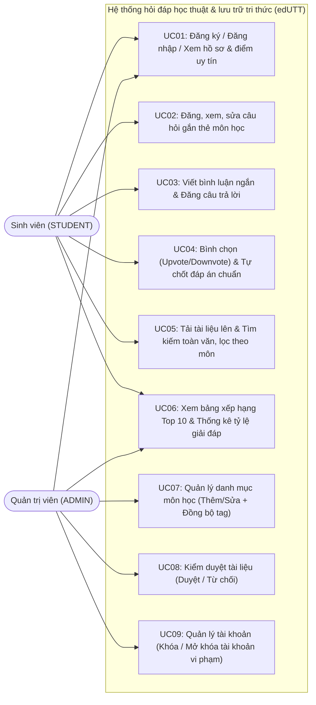
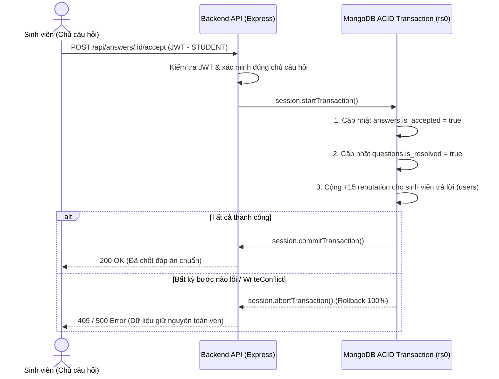
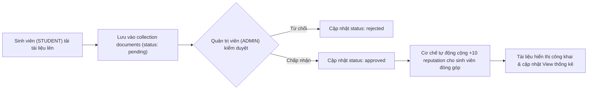
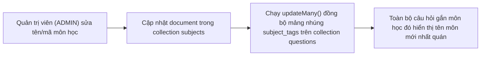
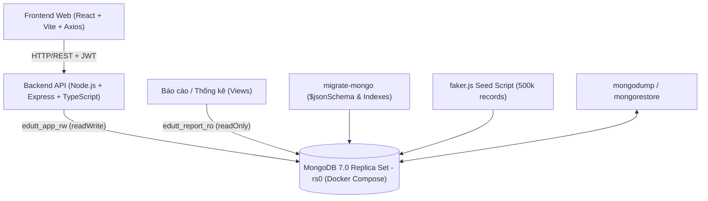

# CHƯƠNG 1: TỔNG QUAN ĐỀ TÀI VÀ ĐẶC TẢ YÊU CẦU HỆ THỐNG (SRS)

- **Đề tài:** Nền tảng hỏi đáp học thuật và lưu trữ tri thức (**edUTT**)
- **Đơn vị:** Nhóm 1 — Đồ án học phần Cơ sở dữ liệu — Trường Đại học Công nghệ Giao thông Vận tải
- **Mô hình:** Cộng đồng sinh viên trao đổi học thuật lẫn nhau (tập trung thiết kế & tối ưu CSDL MongoDB)
- **Người phụ trách chính (Tuần 1):** Phạm Văn Thanh (Nhóm trưởng) — Phối hợp: Cả nhóm
- **Chuẩn đầu ra đáp ứng:** CLO1, CLO7

---

## 1.1. Bối cảnh thực tiễn và mục tiêu bài toán

### 1.1.1. Thực trạng bài toán
Hiện nay, nhu cầu trao đổi học thuật, hỏi đáp bài tập/đồ án và chia sẻ tài liệu ôn thi theo từng học phần của sinh viên tại trường đại học vẫn diễn ra phân tán trên nhiều nhóm mạng xã hội (Facebook, Zalo, Messenger). Cách làm này bộc lộ 3 hạn chế lớn:
1. **Tri thức bị trôi và phân mảnh:** Câu hỏi cũ lặp lại qua từng kỳ học, khó tra cứu lại theo mã môn học hoặc từ khóa chuyên ngành.
2. **Thiếu cơ chế kiểm chứng chất lượng:** Không có công cụ đánh dấu đáp án chính xác nhất hay xếp hạng câu trả lời dựa trên mức độ tin cậy của cộng đồng sinh viên.
3. **Không có kho lưu trữ tài liệu chuẩn hóa:** Đề cương, slide, tài liệu tham khảo thiếu phân loại theo học phần và chưa qua khâu kiểm duyệt.

### 1.1.2. Mục tiêu hệ thống edUTT
Xây dựng nền tảng **edUTT** theo mô hình **cộng đồng sinh viên tự hỗ trợ** nhằm giải quyết triệt để các vấn đề trên:
- Tập trung hóa hoạt động hỏi đáp học thuật theo danh mục môn học của nhà trường (`subjects`).
- Chuẩn hóa chất lượng tri thức thông qua cơ chế cộng đồng tự đánh giá: bình chọn (**Upvote / Downvote**), người hỏi tự chốt đáp án chuẩn (**Accepted Answer**) và tích lũy điểm uy tín (**Reputation**).
- Xây dựng kho tài liệu học tập có quy trình kiểm duyệt (`pending` → `approved` / `rejected`).
- Ứng dụng triệt để các kỹ thuật chuyên sâu của **MongoDB** (Embedding vs. Referencing, `$jsonSchema`, Aggregation Pipeline, Read-only Views, Weighted Text Index, Compound Index ESR, Multi-document ACID Transaction, phân quyền 2 lớp và Backup/Restore).

---

## 1.2. Phân tích tác nhân (Actors) và Ma trận phân quyền (RBAC)

### 1.2.1. Hai nhóm người dùng chính (mô hình cộng đồng sinh viên tự hỗ trợ)

Hệ thống thiết kế gọn gàng với **2 vai trò người dùng** rõ ràng:
1. **Sinh viên (`STUDENT`)**: Thành viên cộng đồng học tập — vừa đặt câu hỏi, chia sẻ tài liệu, vừa giải đáp và đánh giá chéo lẫn nhau.
2. **Quản trị viên (`ADMIN`)**: Sinh viên đại diện ban điều hành hệ thống — quản lý danh mục môn học, kiểm duyệt tài liệu, khóa/mở tài khoản vi phạm và theo dõi thống kê tổng hợp.

| Chức năng / Quyền hạn | Sinh viên (`STUDENT`) | Quản trị viên (`ADMIN`) |
| :--- | :---: | :---: |
| Đăng ký, đăng nhập, xem & cập nhật hồ sơ cá nhân | ✅ | ✅ |
| Tìm kiếm toàn văn, lọc câu hỏi/tài liệu theo môn học, xem chi tiết | ✅ | ✅ |
| Đăng, xem và sửa câu hỏi của chính mình gắn kèm mã môn học (`subject_tags`) | ✅ | ✅ |
| Viết bình luận ngắn (`short_comments`) và đăng câu trả lời (`answers`) | ✅ | ✅ |
| Bình chọn (thích/không thích) cho bài của bạn khác (1 lần/bài, không tự vote) | ✅ | ✅ |
| Tự chốt đáp án chuẩn (`is_accepted`) cho câu hỏi do chính mình đăng | ✅ (chủ câu hỏi) | ✅ |
| Tải tài liệu học tập lên chia sẻ (mặc định trạng thái `pending`) | ✅ | ✅ |
| Xem bảng xếp hạng Top 10 sinh viên tích cực & Thống kê tỷ lệ giải đáp theo môn | ✅ | ✅ |
| Kiểm duyệt tài liệu sinh viên tải lên (`approved` / `rejected`) | ❌ | ✅ |
| Quản lý danh mục môn học (`subjects`: Thêm/Sửa mã môn, tên môn + đồng bộ tag) | ❌ | ✅ |
| Quản lý tài khoản người dùng (Khóa / mở khóa tài khoản vi phạm) | ❌ | ✅ |

### 1.2.2. Hai tài khoản kỹ thuật truy cập trực tiếp CSDL MongoDB (Phân quyền lớp 2)

Ngoài lớp xác thực JWT & kiểm tra vai trò (`STUDENT` / `ADMIN`) tại tầng Backend API, hệ thống thiết lập 2 tài khoản kỹ thuật tách biệt trực tiếp trong nhân MongoDB trên database `edutt`:

| Tài khoản CSDL | Quyền MongoDB | Phạm vi quyền hạn & Mục đích bảo mật |
| :--- | :--- | :--- |
| **`edutt_app_rw`** | `readWrite` trên `edutt` | Dùng cho phần mềm Backend kết nối vào MongoDB; chỉ được phép thêm, xem, sửa, xóa dữ liệu trong cơ sở dữ liệu `edutt`, không có quyền quản trị/xóa toàn bộ hệ thống. |
| **`edutt_report_ro`** | `read` (chỉ đọc Views) | Dùng để xuất báo cáo và xem thống kê; chỉ được phép đọc dữ liệu từ 2 bảng thống kê tổng hợp (`v_top_contributors`, `v_subject_knowledge_stats`), tuyệt đối không thể sửa hay xóa dữ liệu gốc. |

---

## 1.3. Phân tích yêu cầu chức năng (Functional Requirements)

### FR1 — Phân hệ Quản lý người dùng & Xác thực (Auth & Users)
- **FR1.1:** Đăng ký tài khoản mới với mã sinh viên (`student_code`), họ tên (`full_name`), email duy nhất (`email`) và mật khẩu băm bằng `bcryptjs`.
- **FR1.2:** Đăng nhập và cấp phát JWT Token chứa `user_id` và `role` (`STUDENT` hoặc `ADMIN`).
- **FR1.3:** Xem hồ sơ học thuật cá nhân gồm điểm uy tín (`reputation` ≥ 0), số câu hỏi đã đăng, số câu trả lời được chốt chuẩn.
- **FR1.4:** Quản trị viên (`ADMIN`) quản lý danh sách người dùng và thực hiện **khóa / mở khóa** các tài khoản vi phạm.

### FR2 — Phân hệ Quản lý Danh mục Môn học (Subjects)
- **FR2.1:** Quản trị viên (`ADMIN`) thêm mới hoặc sửa mã môn, tên môn (`subject_code` duy nhất, `subject_name`, `credits`, `department`).
- **FR2.2:** Khi tên hoặc mã môn học thay đổi, hệ thống tự động cập nhật đồng loạt mảng nhúng `subject_tags` ở toàn bộ các câu hỏi liên quan trong collection `questions` bằng lệnh `updateMany()`.

### FR3 — Phân hệ Hỏi đáp học thuật (CRUD Q&A)
Bao quát đầy đủ 4 nhóm thao tác dữ liệu trên collection `questions`, `answers` và mảng bình luận ngắn nhúng `short_comments`:
- **FR3.1 — Thêm mới (Create):** Đăng câu hỏi gắn thẻ môn học (`subject_tags`) và tự sinh trường không dấu `search_normalized`; gửi câu trả lời chi tiết (`answers`) kèm mã nguồn/công thức; thêm bình luận nhanh (`short_comments`) bằng toán tử `$push` (kèm giới hạn độ dài & số phần tử để tránh phình to document).
- **FR3.2 — Xem & Tìm kiếm (Read):** Phân trang, lọc theo mã môn / trạng thái giải đáp (`is_resolved`), tìm kiếm toàn văn tiếng Việt (có dấu/không dấu), sắp xếp câu trả lời ưu tiên đáp án chuẩn (`is_accepted: true`) và lượt bình chọn cao nhất (`vote_count` giảm dần).
- **FR3.3 — Cập nhật (Update):** Sửa bài viết đúng tác giả, tăng lượt xem bằng toán tử `$inc`; bình chọn Upvote (`+1`) / Downvote (`-1`) (không được tự bình chọn bài của mình, chặn bình chọn trùng bằng Compound Unique Index); người hỏi tự chốt đáp án chuẩn (`is_accepted = true`, `is_resolved = true`, cộng `+15` `reputation`) đồng bộ trên nhiều bảng bằng **Multi-document ACID Transaction**.
- **FR3.4 — Xóa & Toàn vẹn dữ liệu (Delete):** Rút bình luận ngắn bằng toán tử `$pull`; xóa dây chuyền dữ liệu liên quan (`answers`, `votes` thuộc câu hỏi bị xóa) để tránh phát sinh bản ghi mồ côi.

### FR4 — Phân hệ Lưu trữ Tri thức & Tìm kiếm (Documents & Search)
- **FR4.1:** Sinh viên tải tài liệu học tập (`documents`) lên chia sẻ gắn với một môn học (`subject_id`); tài liệu mới ở trạng thái chờ duyệt (`pending`).
- **FR4.2:** Quản trị viên (`ADMIN`) kiểm duyệt tài liệu (`approved` / `rejected`). Khi tài liệu được duyệt (`approved`), cơ chế tự động (Mongoose Hook) cộng `+10` điểm uy tín cho sinh viên đóng góp.
- **FR4.3:** Tìm kiếm toàn văn (Full-text Search) có trọng số ưu tiên tiêu đề > tên môn học > nội dung, hỗ trợ tiếng Việt có dấu và không dấu (`search_normalized`), kết hợp lọc theo mã môn học và trạng thái giải đáp (`is_resolved`).

### FR5 — Phân hệ Thống kê & Báo cáo học thuật (Analytics & Views)
- **FR5.1:** Bảng xếp hạng **Top 10 sinh viên tích cực** truy xuất từ MongoDB Read-only View `v_top_contributors`.
- **FR5.2:** Bảng thống kê **tỷ lệ câu hỏi đã có đáp án theo từng môn học** và số tài liệu đã duyệt truy xuất từ MongoDB Read-only View `v_subject_knowledge_stats`.

---

## 1.4. Phân tích yêu cầu phi chức năng (Non-Functional Requirements)

| Nhóm yêu cầu | Chỉ tiêu kỹ thuật cần đạt | Giải pháp thực thi |
| :--- | :--- | :--- |
| **NFR1 — Hiệu năng truy vấn** | Tìm kiếm toàn văn & lọc câu hỏi trên tập **100.000 – 500.000 bản ghi** đạt phản hồi nhanh (mục tiêu < 50ms, giảm > 90% so với `COLLSCAN`). | Weighted Text Index + Compound Index theo quy tắc **ESR**, đo kiểm đối chiếu qua `explain("executionStats")`. |
| **NFR2 — Tính nguyên tử & Đồng thời** | Khi nhiều sinh viên cùng bấm bình chọn hoặc chốt đáp án đồng thời, không phát sinh sai lệch `vote_count` hay `reputation`. | Compound Unique Index trên `votes` + **Multi-document ACID Transaction** (`ClientSession`) trên Replica Set. |
| **NFR3 — Toàn vẹn dữ liệu** | Không cho để trống mục bắt buộc, không cho `reputation < 0`, không cho tự vote hoặc vote trùng 2 lần. | `$jsonSchema` Validation (`validationLevel: "strict"`, `validationAction: "error"`) + Unique Index cài đặt ngay trong MongoDB. |
| **NFR4 — Khả năng phục hồi** | Có khả năng sao lưu nóng định kỳ và khôi phục toàn vẹn 100% sau sự cố xóa nhầm collection. | Script `mongodump --gzip` và diễn tập `mongorestore --drop`. |
| **NFR5 — Bảo mật phân quyền** | Tách biệt quyền thao tác ứng dụng và quyền đọc báo cáo; chặn truy cập trái phép giữa `STUDENT` và `ADMIN`. | RBAC 2 lớp: JWT Middleware + tài khoản MongoDB `edutt_app_rw` & `edutt_report_ro`. |

---

## 1.5. Phân tích 6 thực thể cốt lõi (Core Entities)

Hệ thống được thiết kế với **6 Collection chính** trong cơ sở dữ liệu `edutt` (chi tiết sơ đồ & ràng buộc sẽ chốt ở Tuần 2 – Tuần 3):

1. **`users`**: Thông tin sinh viên / quản trị viên (`student_code`, `full_name`, `email`, `password_hash`, `role: STUDENT | ADMIN`, `is_active`, `reputation >= 0`).
2. **`subjects`**: Danh mục học phần (`subject_code`, `subject_name`, `credits`, `department`).
3. **`questions`**: Câu hỏi học thuật; **nhúng (Embed)** mảng `subject_tags` và mảng `short_comments`; lưu thêm `search_normalized` (tiếng Việt không dấu).
4. **`answers`**: Câu trả lời chi tiết; **tham chiếu (Reference)** tới `question_id` và `author_id`, lưu `vote_count`, `is_accepted`.
5. **`documents`**: Tài liệu học tập; **tham chiếu (Reference)** tới `subject_id` và `uploader_id`, lưu trạng thái kiểm duyệt `status` (`pending | approved | rejected`).
6. **`votes`**: Lịch sử bình chọn của sinh viên trên câu hỏi/câu trả lời; áp đặt **Compound Unique Index** trên `(user_id, target_id, target_type)`.

---

## 1.6. Sơ đồ Use Case & Luồng nghiệp vụ trọng tâm

### 1.6.1. Sơ đồ Use Case tổng quát hệ thống edUTT

### 1.6.2. Luồng Sinh viên tự chốt đáp án chuẩn (ACID Transaction)

### 1.6.3. Luồng Tải lên & Kiểm duyệt Tài liệu (Tự động cộng điểm uy tín)

### 1.6.4. Luồng Quản trị viên sửa tên môn học (Đồng bộ dữ liệu nhúng)

---

## 1.7. Kiến trúc hệ thống & Ngăn xếp công nghệ

